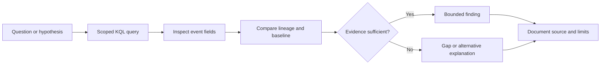

# Evidence Before Conclusions
### A KQL threat-hunting case study

**Kofi Williams** · [GitHub](https://github.com/Kofi1011) · Microsoft Defender Advanced hunting · Microsoft Sentinel · KQL

A security investigation is only as strong as the evidence behind its conclusions. This case study examines a simulated intrusion and the work required to separate malicious activity, ordinary application behaviour, and unsupported success claims.

The exercise was **Operation QUARTZFANG**, a CyberRange threat hunt. The platform recorded **28/28 flags, 8/8 sections and 2850/2850 points, completed on time on November 2, 2026**. Those numbers describe the exercise outcome; they are not a production incident metric or a professional certification.

## Start here

| Resource | What it demonstrates |
|---|---|
| [Investigation case study](docs/case-study.md) | Evidence-led analysis, alternative explanations and careful conclusions |
| [Evidence matrix](docs/evidence-matrix.md) | The connection between an observation, a conclusion and its limits |
| [KQL library](queries/README.md) | Reusable approaches for process lineage, network context, baselines and log review |
| [Detection opportunities](docs/detection-opportunities.md) | How findings could inform future monitoring, with validation requirements |
| [Method and limitations](docs/method-and-limitations.md) | Timestamp handling, mixed runs, duplicate rows and reproducibility |

## Investigation highlights

- **Process lineage:** a common file-reading utility becomes significant when its parent is the established shell process rather than the application.
- **Claim validation:** an agent's report of successful secret retrieval was contradicted by an API access-denied response.
- **Traffic context:** HTTPS port usage and a reused service account did not distinguish legitimate sessions from the suspicious process chain.
- **Disconfirmation:** pre-existing backup activity and a database connection-capacity problem provided explanations for activity that initially resembled the intrusion.

## Tools and scope

The investigation used Microsoft Defender Advanced hunting with a connected Sentinel workspace and custom lab tables: endpoint process/file/network events, Syslog, portal access logs, registry access logs and agent logs. This repository contains analysis and defensive query patterns, not a deployed detection system.

The public queries use generalized host names and configurable time windows. They are **adapted templates**, not unmodified exports or independently re-executed production queries. Read the [query notes](queries/README.md) before use.

## Publication scope

This is a simulated training case study. Passwords, tenant identifiers, raw telemetry exports, the exact flag answer sequence and exploit payloads are excluded. The write-up generalizes scenario details so that its value is the reasoning rather than an answer key. CyberRange retains ownership of its exercise material. No public redistribution policy for full solutions was verified when this package was prepared.

## About

I am building a portfolio focused on SOC analysis, Microsoft security tooling and evidence-based threat hunting. This project documents an investigation approach that can be discussed, questioned and reproduced against an appropriately authorized dataset.

## References

- [Microsoft: Advanced hunting query best practices](https://learn.microsoft.com/en-us/defender-xdr/advanced-hunting-best-practices)
- [Microsoft: Advanced hunting with Microsoft Sentinel data](https://learn.microsoft.com/en-us/defender-xdr/advanced-hunting-microsoft-defender)
- [MITRE ATT&CK: Obtain Capabilities — Artificial Intelligence](https://attack.mitre.org/techniques/T1588/007/)

